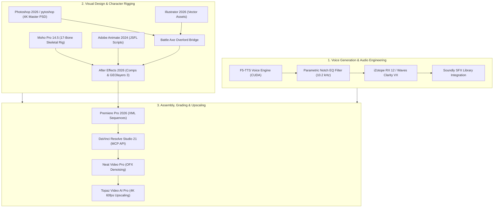

# StickFacts Creative Pipeline Automation Bridge

An autonomous, end-to-end creative production engine designed for producing viral, high-retention **YouTube Shorts** for **StickFacts**. 

This repository provides full programmatic control, automation bridges, and verified asset pipelines across 8 professional creative applications, AI voice generation, upscaling suites, and industry-standard audio/visual plugins on Windows.

Any autonomous AI agent (or human creator) can clone or install this repository, read `config.json`, and immediately pilot all integrated software at 100% capability.

---

## 🚀 System Architecture & Capabilities



---

## 🛠️ Integrated Creative Applications & Control Methods

All software paths and parameters are centrally registered in [`config.json`](file:///C:/Users/jofin/.gemini/antigravity/scratch/creative_pipeline_bridge/config.json).

| Application | Version | Automation Method | Module / Entrypoint |
| :--- | :--- | :--- | :--- |
| **DaVinci Resolve Studio** | 21.1.1 | MCP Server / Python Scripting API | Active MCP Server |
| **Adobe Photoshop** | 2026 (v27.11) | COM (`Photoshop.Application`) + ExtendScript (JSX) + `pytoshop` | `bridge.photoshop_tool.PhotoshopTool` |
| **Adobe Illustrator** | 2026 (v30.8) | COM (`Illustrator.Application`) + ExtendScript (JSX) | `bridge.illustrator_tool.IllustratorTool` |
| **Adobe After Effects** | 2026 (v26.5) | CLI Scripting (`AfterFX.exe -r <jsx>`) + `aerender.exe` | `bridge.aftereffects_tool.AfterEffectsTool` |
| **Adobe Premiere Pro** | 2026 (v26.5) | Final Cut Pro XML Sequences + `PProHeadless.exe` | `bridge.premiere_tool.PremiereTool` |
| **Adobe Animate** | 2024 (v24.0) | Direct CLI Script Execution (`Animate.exe "<script.jsfl>"`) | `bridge.animate_tool.AnimateTool` |
| **Moho Pro** | 14.5 | CLI Lua Engine (`Moho.exe -r <script.lua>`) + JSON Rig Generator | `bridge.moho_tool.MohoTool` |
| **ComfyUI Desktop** | 1.1.7 | REST API & WebSocket Client (`http://127.0.0.1:8188`) | `bridge.comfy_tool.ComfyTool` |
| **F5-TTS Voice Engine** | v1_Base | PyTorch CUDA accelerated voice cloning | `bridge.voice_tool.VoiceTool` |
| **Topaz Video AI Pro** | 7.1.6 | CLI Embedded FFmpeg (`ffmpeg.exe`) & Standalone UI | `config.json` -> `topaz_video_ai` |
| **iZotope RX 12 Advanced**| 12.0 | VST3 plugin suite + Standalone Batch Audio Processor | `config.json` -> `izotope_rx` |
| **Soundly SFX Manager** | Latest | Soundly SFX Desktop App + `SoundlyMonitor.vst3` | `config.json` -> `soundly` |

---

## 📦 Desktop Suite & Plugins Directory

All installed applications, installers, and extracted plugins are organized in the user's desktop workspace at:
`C:\Users\jofin\Desktop\StickFacts_Creative_Suite\`

### Plugins Directory (`Plugins/`)
- **Neat Video Pro 6.1.3 for Resolve**: OpenFX video noise reduction and temporal artifact removal.
- **Boris FX Sapphire 2026**: High-end VFX, glows, lens flares, and light effects for After Effects & Resolve.
- **Boris FX Mocha Pro 2026**: Advanced planar motion tracking and rotoscoping.
- **FabFilter Total Bundle 2026**: Professional audio mixing (Pro-Q 3 equalizer, Pro-L 2 limiter, Pro-C 2 compressor).
- **GEOlayers 3 v1.19.0**: Map animation and geographic data visualization plugin for After Effects.
- **Battle Axe Overlord v2.7.3**: Instant vector synchronization bridge between Adobe Illustrator and After Effects.
- **Waves Ultimate 2026 / Clarity VX**: AI-driven neural voice isolation and audio cleaning.

### Installers Directory (`Installers/`)
- `soundly-setup.exe` (Soundly sound effect library manager)
- `Topaz Video AI Pro 7.1.6` installer
- `iZotope RX 12 Advanced` installer

---

## 🎨 Master Character & Assets

The official mascot for **StickFacts** is a high-contrast, professional 2D vector stickman wearing an orange safari/explorer hat and an electric cyan scarf (`#00E5FF`), holding a stylized magnifying glass.

All master assets are generated and located in [`output/`](file:///C:/Users/jofin/.gemini/antigravity/scratch/creative_pipeline_bridge/output):

- **`StickFacts_Master_Character.psd`** (4K UHD 3840x2160, 300 DPI):
  - `Poses (Animation)`: 4 full-body poses (Investigating with magnifying glass, Explaining/pointing up, Shocked/mind-blown, Thinking with hand on chin).
  - `Expressions (Ansiktsuttryck)`: 4 facial variations (Curious Investigator, Excited Eureka, Shocked Baffled, Smug Knowing Smile).
  - `Master Hero Mascot`: Full-body crisp vector character with transparent alpha channel.
  - `Background`: Solid studio white.
  *(A copy is placed directly on the Desktop for instant opening in Photoshop).*
- **`StickFacts_Master_Rig.moho`**: 17-bone Moho 14 skeletal rig compatible with smart bone dial animation.
- **`assets/voice_ref/stickfacts_brand_voice.wav`**: Reference audio for the brand voice ("Some call me nature, others call me mother nature.").
- **`output/stickfacts_hook_master_approved.wav`**: Approved master reference hook with calibrated Notch EQ filtering applied.

---

## ⚡ Quick Start for AI Agents & Developers

### 1. Prerequisites & Environment
Ensure Python 3.11+ is installed with required packages:
```bash
pip install win32com pillow numpy opencv-python pytoshop psd-tools
```

### 2. Verify System Configuration
Check that all applications and tools are detected:
```bash
python bridge_cli.py check-all
```

### 3. Generate Official Brand Voiceover
Generate audio with automatic brand voice cloning and parametric Notch EQ:
```bash
python -m creative_pipeline_bridge.bridge.voice_tool --text "Did you know that honey never spoils? Archaeologists found 3000 year old pots that are still edible!" --output "output/my_short_voiceover.wav"
```

### 4. Compile or Update Master Character PSD
Rebuild the 4K multi-layer Photoshop file at any time:
```bash
python scripts/generate_master_psd_pytoshop.py
```

### 5. Build an After Effects Composition
Generate an After Effects `.jsx` script that creates a 1080x1920 (9:16 vertical) composition:
```python
from bridge.aftereffects_tool import AfterEffectsTool

ae = AfterEffectsTool()
jsx_script = ae.generate_comp_builder_script(
    comp_name="StickFacts_Short_01",
    width=1080,
    height=1920,
    duration_sec=30.0,
    fps=30.0
)
```

### 6. Export Premiere Pro / DaVinci Resolve Timeline
Create a Final Cut Pro XML sequence ready for instant import:
```python
from bridge.premiere_tool import PremiereTool

prem = PremiereTool()
xml_path = prem.create_sequence_xml(
    seq_name="StickFacts_Timeline_01",
    width=1080,
    height=1920,
    fps=30.0,
    output_path=Path("output/my_sequence.xml")
)
```

---

## 🔒 Memory & System Protection Guardrails

To prevent crashes or out-of-memory errors on local hardware (16 GB System RAM, NVIDIA RTX 3080 10 GB VRAM):
- Always run heavy inference (voice synthesis, ComfyUI, or Topaz AI) sequentially, never concurrently.
- Clean up unused COM application instances after headless execution using `tool.quit_app()`.
- Avoid loading uncompressed 4K video frames entirely into RAM; use streaming generators and temporary disk caching.

---

## 📄 License & Attribution
Developed exclusively for the **StickFacts** YouTube Shorts production channel.
All rights reserved.
